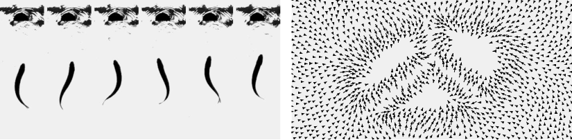
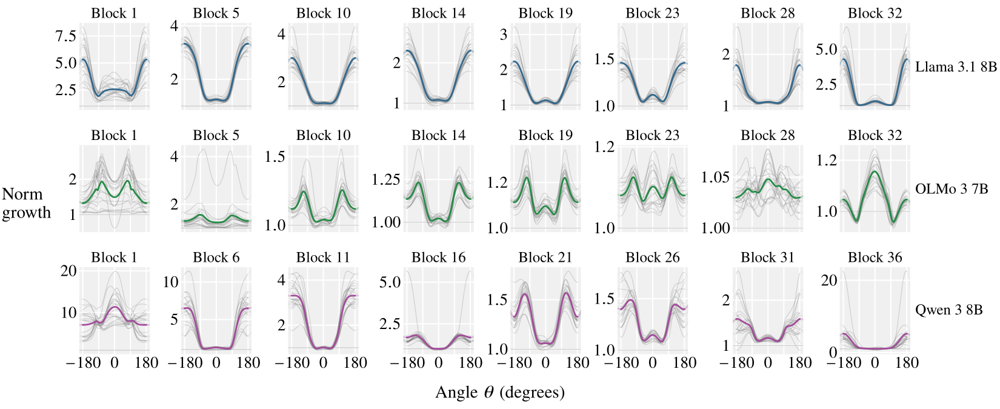
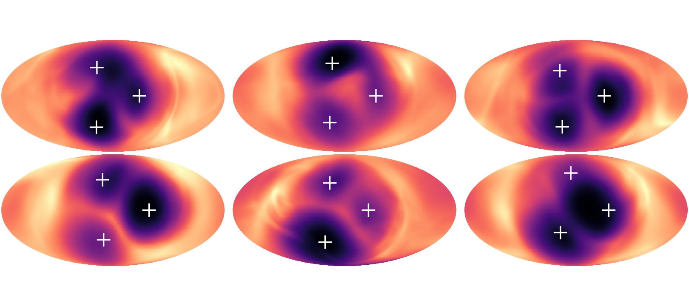
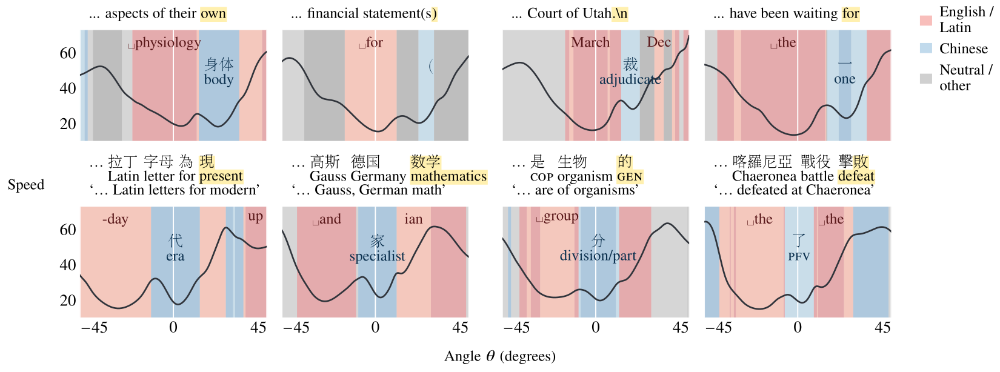
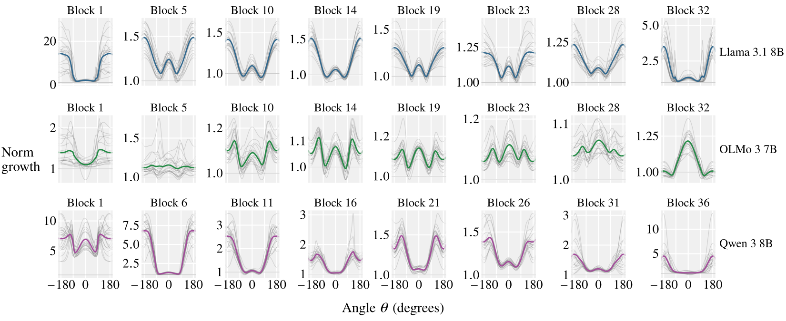
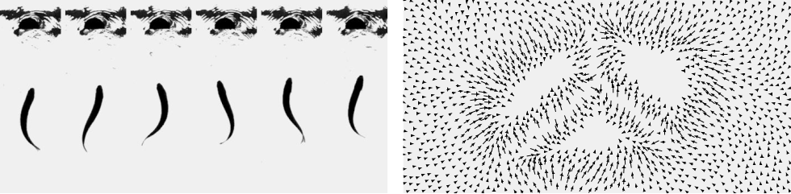
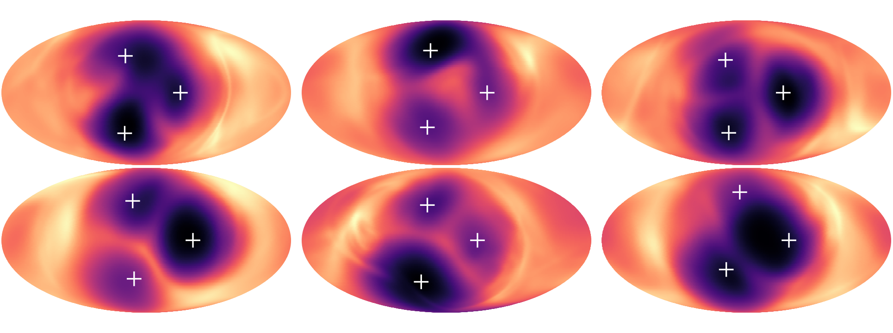
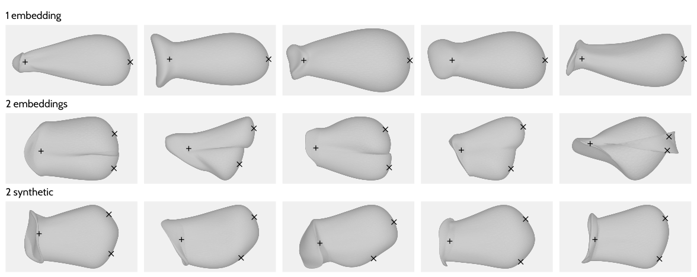
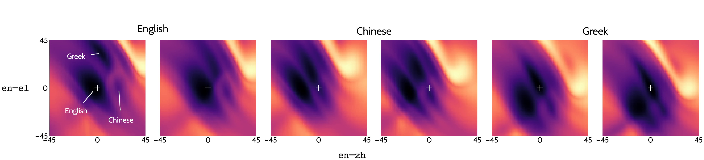
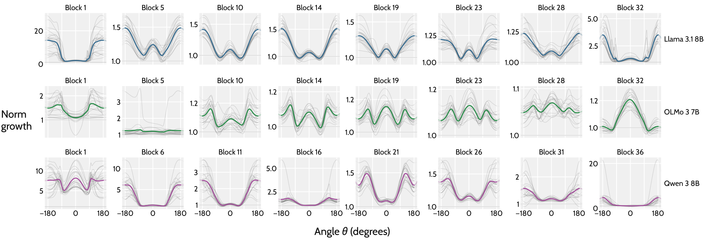

# Manifold attractors: figure reproduction

Standalone source package for paper commit
`ed8b89bc8344db678eb5e360a1893937d3b94a1f`: all **16 included PDFs and two inline
TikZ artworks**, main text and appendix, in ICLR and Goodfire styles.
No dependency on the original project/paper checkout, archived experiment data,
or precomputed activations. Only required numerical kernels and renderers are
retained. Public weights/corpora are downloaded; numerical intermediates are
computed locally. Literal prompts, human-authored labels, and the source fish
GIF are source inputs, not precomputed experiment results.

**Target: scientific reproduction, not mandatory pixel identity.** Inconsequential
hardware-rounding and typographic differences are acceptable; changing sampled
tokens or numerical conclusions is not. Full-size computation is in progress,
with completed images and per-artwork validation below. Missing original TeX
preambles are replaced by explicitly documented reconstructions; source and
corpus-selection provenance limitations remain in [AUDIT.md](AUDIT.md).

## Setup and commands

Install [uv](https://docs.astral.sh/uv/) and use this source checkout (`uv sync`
creates an editable installation). Generation requires substantial CPU RAM and
a CUDA GPU suitable for float32/float64 8B models. Accept the gated Meta model
licenses and authenticate with Hugging Face before downloading weights.
Rendering needs LuaLaTeX and the TeX/font packages listed in [RENDER.md](RENDER.md).
That document now includes a rootless, hash-pinned TeX Live 2025 / LuaHBTeX 1.21
setup and a locked PDF rasterizer.

```sh
uv sync --locked --extra compute --extra render
uv run reproduce list
uv run reproduce plan                     # full dependency graph, no computation
uv run --extra compute reproduce run data --resume  # numerical generation only
make smoke                                # source GIF + deterministic field; no models/TeX
make test                                 # CPU/tiny-model integration and unit tests
```

After activating the TeX and rasterizer environment from `RENDER.md`:

```sh
uv run --extra compute reproduce run --resume
uv run --extra compute reproduce run --style goodfire --resume
uv run reproduce check                    # optional STRICT pixel-reference comparison
```

Documented reconstructed typography is allowed by default; numerical checks
remain mandatory. `--require-original-styles` enables strict provenance mode
and fails until the four original preambles are recovered. The older explicit
`--allow-reconstructed-styles` flag remains supported. A single task ID may replace `data`, e.g.
`reproduce run data-great_circle_norm_grid-llama3 --resume` inside the compute
environment. Optional SLURM submission, from this checkout:

```sh
sbatch scripts/reproduce.sbatch iclr data
```

The template requests one GPU for up to three days, using cluster-default
partition/CPU/RAM settings. Adjust the wall-time to your resources. No jobs are
submitted automatically.

## Reproducibility contract

- `configs/{core,maps,render}.json` is the explicit task DAG.
  `plan` prints actual commands; no hidden call to the old project is needed.
- Models and available corpora are revision-pinned; input hashes and frozen
  token records guard against silently changing examples. Human-reviewed labels
  remain source labels rather than invented translations of regenerated tokens.
- `uv.lock` locks modern computation and two **incompatible** plotting stacks.
  The runner automatically uses isolated `render` / `render-bubble` extras;
  invoking a script as a module alone would not honor its PEP 723 pins.
- Refusal-vector extraction downloads only pinned public author code and input
  splits, **not** published directions/activations/completions. Its historical
  Python 3.10 / Torch 2.3 / Transformers 4.41 environment is separately pinned.
  All other computation uses the modern compute environment.
- `--resume` skips a task only after checking source/config fingerprints and
  declared output hashes. Scientific data are shared between styles. Generator
  checkpoints retain their own numerical-contract checks. Use an empty `data/`
  for a genuinely fresh full run; no generated data are shipped in Git.
- Task logs/timing/provenance live in `runs/`; generated outputs in `data/` and
  `fig/`; downloaded author source in `external/`. These are all Git-ignored.

The optional strict `check` compares canonical decoded PNG pixels for the 15 scientific figures and
embedded image pixels/page geometry for the simple fish PDF. Original file
hashes are also retained as provenance. PDF timestamps and PNG encoding are not
scientific differences. No original standalone reference was supplied for the
two inline artworks, so they are reported **UNVERIFIED**, never silently passed.
Exit codes: 1 for missing/different artwork, 2 for incomplete reference coverage,
0 only for complete matching coverage. A nonzero strict pixel result is not
itself a scientific failure: see the separate scientific-validation evidence.
Pixel agreement alone is not proof of a from-scratch execution; keep run provenance too.

## What was actually checked

The original **38-test suite passed** in a fresh Git clone with isolated locked
environments and no original `data/` or `fig/` directories; subsequent regression
tests also cover download scope and safe figure publication. CPU mathematical and
tiny-random-model integration tests exercise the core and advanced generators
without pretrained weights or old result arrays. The source
GIF regenerates historical fish PDF pixels/placement exactly; the schematic's
1,304-vector table matches its historical SHA256. A public Pile input was
independently downloaded into an empty cache and matched its pinned hash; the
pinned author source was also fetched into a fresh temporary checkout without
published run artifacts. Both isolated plotting environments resolve and their
CLIs work. Two independent rootless TeX installations produced identical smoke
images with no missing-glyph or font-substitution warnings. These checks do not
substitute for the full-size numerical and per-artwork comparisons below.

Protocol details and limitations: [CORE.md](CORE.md), [MAPS.md](MAPS.md),
[RENDER.md](RENDER.md), [AUDIT.md](AUDIT.md). Tables, legacy diagnostic plots,
and full-manuscript pagination are deliberately out of scope.

<!-- reproduced-figures:start -->
## Reproduced figures

These are **newly generated results**, not copies of the paper figures. Numerical experiments use the standalone package; typography uses explicitly reconstructed styles.

Published **20/36** style-specific artworks; **3** pass the optional exact image check. **Pixel identity is not required**: small hardware-rounding and typographic differences are acceptable when scientifically inconsequential. Token selection, numerical results and conclusions must remain faithful. The per-artwork report distinguishes scientific validation from pixel identity; inline artworks lack historical image references.

[Per-artwork hashes and validation](docs/figures/validation.json). [Protocols and limitations](AUDIT.md).

<details open>
<summary>ICLR figures</summary>

### Intro

Scientific validation: **source reproduced**. No historical reference — unverified. [PDF](docs/figures/iclr/intro.pdf)



### Sphere probe

Scientific validation: **source reproduced**. No historical reference — unverified. [PDF](docs/figures/iclr/sphere_probe.pdf)


### Great circle norm grid

Scientific validation: **correcting sampling regression**. Reference pixels differ. [PDF](docs/figures/iclr/great_circle_norm_grid.pdf)



### Triple area heatmaps

Scientific validation: **inconsequential numerical differences**. Reference pixels differ. [PDF](docs/figures/iclr/triple_area_heatmaps.pdf)



### Bubble coords

Scientific validation: **exact numerics**. Exact reference pixels. [PDF](docs/figures/iclr/bubble_coords.pdf)


### Refusal steering heatmaps

Scientific validation: **pending**. Reference pixels differ. [PDF](docs/figures/iclr/refusal_steering_heatmaps.pdf)


### Language area heatmaps

Scientific validation: **pending**. Reference pixels differ. [PDF](docs/figures/iclr/language_area_heatmaps.pdf)


### Language steering speed

Scientific validation: **pending**. Reference pixels differ. [PDF](docs/figures/iclr/language_steering_speed.pdf)



### Great circle norm grid context

Scientific validation: **correcting sampling regression**. Reference pixels differ. [PDF](docs/figures/iclr/great_circle_norm_grid_context.pdf)



Fish component: [Exact embedded image and placement](docs/figures/iclr/dead_fish_sequence.pdf).

</details>

<details >
<summary>Goodfire figures</summary>

### Intro

Scientific validation: **source reproduced**. No historical reference — unverified. [PDF](docs/figures/goodfire/intro.pdf)



### Sphere probe

Scientific validation: **source reproduced**. No historical reference — unverified. [PDF](docs/figures/goodfire/sphere_probe.pdf)


### Great circle norm grid

Scientific validation: **correcting sampling regression**. Reference pixels differ. [PDF](docs/figures/goodfire/great_circle_norm_grid.pdf)


### Triple area heatmaps

Scientific validation: **inconsequential numerical differences**. Reference pixels differ. [PDF](docs/figures/goodfire/triple_area_heatmaps.pdf)



### Bubble coords

Scientific validation: **exact numerics**. Reference pixels differ. [PDF](docs/figures/goodfire/bubble_coords.pdf)



### Refusal steering heatmaps

Scientific validation: **pending**. Reference pixels differ. [PDF](docs/figures/goodfire/refusal_steering_heatmaps.pdf)


### Language area heatmaps

Scientific validation: **pending**. Reference pixels differ. [PDF](docs/figures/goodfire/language_area_heatmaps.pdf)



### Language steering speed

Scientific validation: **pending**. Reference pixels differ. [PDF](docs/figures/goodfire/language_steering_speed.pdf)


### Great circle norm grid context

Scientific validation: **correcting sampling regression**. Reference pixels differ. [PDF](docs/figures/goodfire/great_circle_norm_grid_context.pdf)



Fish component: [Exact embedded image and placement](docs/figures/goodfire/dead_fish_sequence.pdf).

</details>

Still pending: `iclr/great_circle_synthetic_grid`, `iclr/norm_growth_trajectory_starts`, `iclr/synthetic_profile_trajectory`, `iclr/great_circle_pair_speed_grid`, `iclr/norm_growth_trajectory_starts_appendix`, `iclr/great_circle_speed_grid`, `iclr/great_circle_synthetic_speed_grid`, `iclr/great_circle_pair_speed_grid_appendix`, `goodfire/great_circle_synthetic_grid`, `goodfire/norm_growth_trajectory_starts`, `goodfire/synthetic_profile_trajectory`, `goodfire/great_circle_pair_speed_grid`, `goodfire/norm_growth_trajectory_starts_appendix`, `goodfire/great_circle_speed_grid`, `goodfire/great_circle_synthetic_speed_grid`, `goodfire/great_circle_pair_speed_grid_appendix`.

<!-- reproduced-figures:end -->
